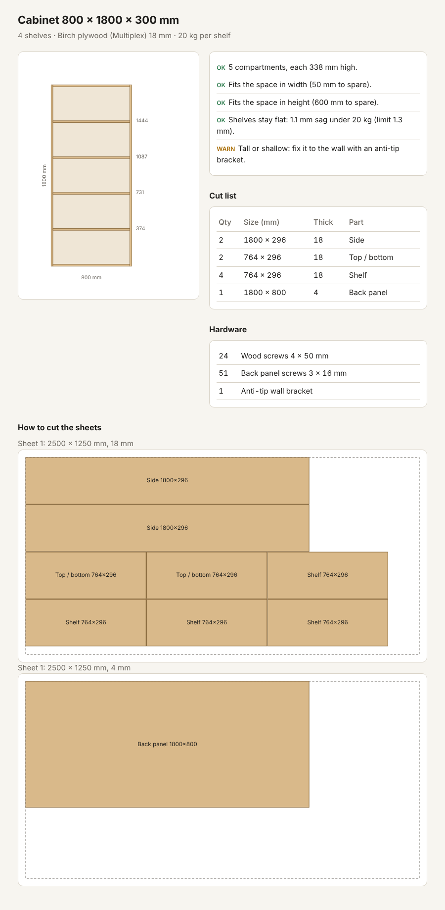

# say-and-build

Describe the furniture you want. Get a plan you can actually build.

Today, if you want a shelf that fits your exact space, you buy something close
enough or pay a carpenter. say-and-build turns a description into a checked
building plan: drawing, cut list, sheets to buy, screws, and shelf heights.

The goal is bigger than furniture: anyone should be able to make what they need
by describing it, without being a designer. Furniture is the first piece.

## How it works

1. **AI understands** what you want and turns it into a spec (size, shelves, load). *(next step)*
2. **Code designs** the real parts from the spec.
3. **Code checks** that the design works before you cut anything:
   - compartments are tall enough
   - it fits your space
   - shelves will not bend under the load (beam formula)
   - tall pieces need a wall bracket
   - every part can be cut from a standard 2500 x 1250 mm sheet
4. **You get** a cut list for a DIY store's cutting service, a sheet layout, and a hardware list.

The AI never invents dimensions. It only interprets your words; every number
comes from code you can check.



## Try it

```
python3 furniture.py examples/bookshelf.json          # text report
python3 render.py examples/bookshelf.json plan.html   # drawing, open plan.html in a browser
python3 furniture.py examples/too_wide.json           # a design that gets rejected, with reasons
```

No libraries needed, just Python 3.

## Status

- [x] Cabinet / bookshelf engine with checks, cut list, sheet layout, hardware
- [ ] Describe it in words (AI turns text into a spec)
- [ ] Fit to a photo of your space
- [ ] Order sheet for a store's cutting service
- [ ] More furniture types
